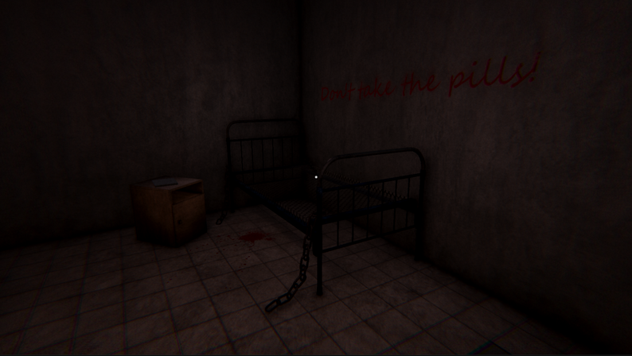
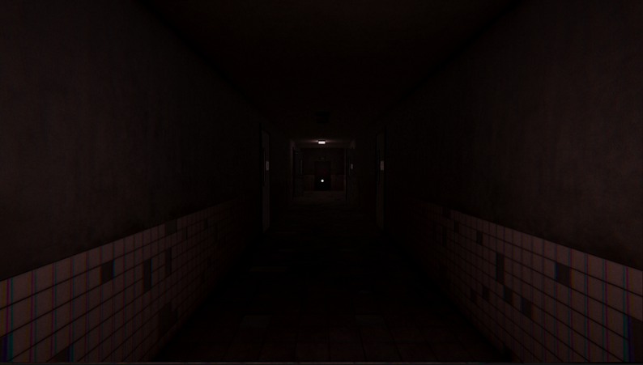
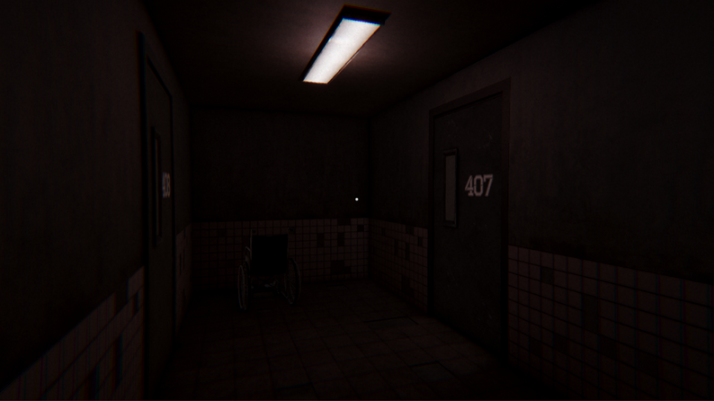
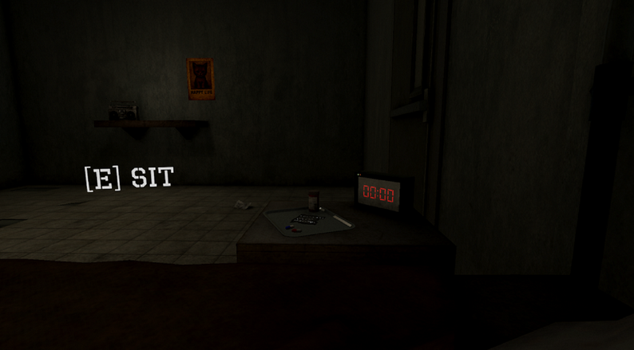

# Room 407

A short psychological horror prototype set in an asylum room, playable right in your browser.

  

  

  
  
  

## About

You wake up in an asylum room. You don't know why you're here.

A note on the bedside table says: *"Take the red pill at 8 AM. Take the blue pill at 9 PM."* But the clock is broken, so you take both.

Reality begins to shift. The room gets darker, the paintings twist, and a news report whispers of evacuation. Can you escape the asylum before it's too late?

## Controls

| Key | Action |
|---|---|
| `W` `A` `S` `D` | Move |
| `Shift` | Run |
| `E` | Interact |
| `+` / `-` | Adjust brightness |

## Details

- **Engine:** Unity (WebGL / HTML5)
- **Genre:** First-person psychological horror
- **Status:** Prototype, published May 2025
- **Origin:** Built in two weeks for a university *Game Development* course
- **AI disclosure:** AI-assisted graphics and sounds

## Author

**Sina** · [itch.io](https://drxenon.itch.io) · [GitHub](https://github.com/DrXenonn)
